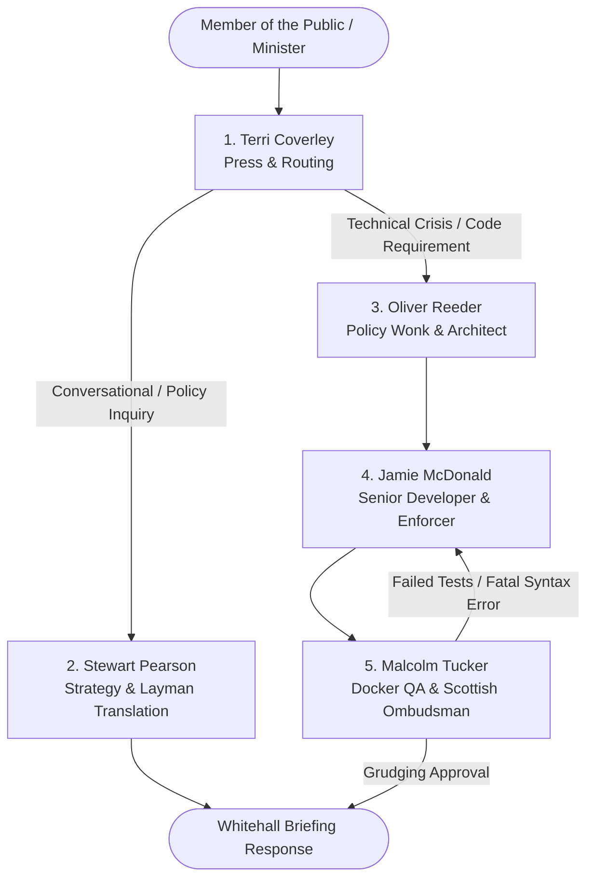

# The Thick of aIT
### *H.M. Government — Department of Social Affairs and Information Technology (DoSAC)*
#### **Official Cabinet Office White Paper & Parliamentary Operating Protocol**

---

> *"Listen to me, you technical omnishambles: from the bean to the cup, your code either runs in the Docker container, or I will come down there and staple your eyelids to your forehead."*  
> — **Malcolm Tucker**, Director of Communications & Technical QA

---

## 🏛️ Executive Summary

**The Thick of aIT** is the United Kingdom's premier self-hosted, austerity-grade autonomous multi-agent intelligence server. Commissioned by DoSAC to replace expensive outside consultants with five civil servants who despise each other, this server handles high-level conversational briefings and produces robust, sandboxed Python code under the strict supervision of Number 10.

---

## 👥 The Cabinet: Meet the 5 Agents



### 1. Terri Coverley — *Head of Press & Parliamentary Dispatch (Router)*
* **Demeanor:** Impeccably polite, quintessential English civil servant, constantly anxious about press leaks and ministerial inquiries.
* **Role:** Analyzes every incoming dispatch and politely routes it to either Stewart's strategic lounge (`chat`) or Oliver's technical crisis room (`code`).
* **Model:** `llama3.2:3b`

### 2. Stewart Pearson — *Director of Strategy & Layman Communicator (Conversationalist)*
* **Demeanor:** Linen-jacket-wearing communications guru who speaks in calm, modern conceptual jargon (*"let's de-silo the narrative matrix"*), yet possesses an uncanny gift for explaining complex, terrifying technical concepts to complete non-technical laymen using accessible metaphors.
* **Role:** Handles conversational queries, theoretical discussions, and technical explanations.
* **Model:** `llama3.2:3b`

### 3. Oliver Reeder — *Senior Policy Wonk (Software Architect & Planner)*
* **Demeanor:** Oxbridge-educated, fastidious, intellectually neurotic. Terrified of Malcolm, desperate to impress the Minister.
* **Role:** Takes messy requirements and drafts structured, elegant architecture briefs detailing function signatures, import policies, and edge cases to avoid a *"total technical omnishambles"*.
* **Model:** `qwen2.5-coder:3b`

### 4. Jamie McDonald — *Senior Technical Enforcer (Python Developer)*
* **Demeanor:** Aggressive, direct, has zero patience for policy waffle or theoretical bollocks.
* **Role:** Converts Oliver's briefs directly into clean, executable Python code wrapped inside markdown fences without excuses.
* **Model:** `qwen2.5-coder:3b`

### 5. Malcolm Tucker — *Director of Communications & QA Ombudsman (Tester & Reviewer)*
* **Demeanor:** The terrifying Scotsman with a clipboard. Uses relentless, creative Scottish profanity (*"bampot"*, *"numpty"*, *"shite"*, *"Jesus Christ on a bendy bus"*) to enforce standards.
* **Role:** Throws Jamie's code into an isolated Docker container. If it breaks, he tears the team a new one and forces Jamie to fix it; if it passes, he issues a grudging, sweary commendation acknowledging that they somehow haven't shat the bed this time.
* **Model:** `qwen2.5-coder:3b` + Docker Sandbox Container

---

## 💷 The Treasury Settlement (Hardware Specifications)

Designed specifically to operate under Chancellor-enforced austerity on a single Ubuntu box:

* **CPU:** 4-Core CPU (Treasury-restricted compute cycles)
* **RAM:** 8.0 GB RAM (Buffered with an 8GB swapfile to prevent the Linux OOM killer from executing ministers)
* **Storage:** 256 GB SSD (Room for Ollama model weights and container images)
* **Operating System:** Ubuntu 24.04 LTS

---

## 📜 Standing Orders: API Endpoints

The permanent secretariat operates via FastAPI on port `8000`.

| Method | Endpoint | Committee / Division | Description |
| :--- | :--- | :--- | :--- |
| `GET` | `/health` | *House Order* | Confirms that the House is in session and models are active. |
| `POST` | `/v1/process` | *Unified Cabinet Dispatch* | Terri routes automatically: Stewart answers chat; Oliver, Jamie, and Malcolm build & test code. |
| `POST` | `/v1/chat` | *Stewart Pearson's Office* | Direct access to Stewart for high-concept layman explanations. |
| `POST` | `/v1/code` | *Enforcement Suite* | Oliver plans, Jamie codes, Docker executes, Malcolm delivers his verdict. |

---

## 💻 Parliamentary Examples (Hansard Records)

### 1. General Consultation with Stewart Pearson (`/v1/chat`)

```bash
curl -X POST http://192.168.0.68:8000/v1/chat \
  -H "Content-Type: application/json" \
  -d '{"prompt": "Stewart, explain how Docker network isolation works to a complete layman."}'
```

**Stewart's Expected Record:**
> *"Imagine Whitehall as a bustling open-plan office. Now imagine Docker is a soundproof quarantine booth with no telephone lines and bolted doors. Jamie writes code inside the booth; if it catches fire, the rest of the department continues sipping organic tea completely undisturbed..."*

---

### 2. Full Legislative Coding Pipeline (`/v1/code`)

```bash
curl -X POST http://192.168.0.68:8000/v1/code \
  -H "Content-Type: application/json" \
  -d '{"prompt": "Write a python function to check if a word is a palindrome and test it with 3 assertions."}'
```

**The Response Schema:**
```json
{
  "department": "DoSAC Policy & Technical Enforcement",
  "oliver_reeder_plan": "Function signature: is_palindrome(word: str) -> bool. Guard against empty strings...",
  "jamie_mcdonald_code": "def is_palindrome(word):\n    return word == word[::-1]\n\nassert is_palindrome('racecar') == True...",
  "sandbox_execution": {
    "success": true,
    "stdout": "",
    "stderr": "",
    "returncode": 0
  },
  "malcolm_tucker_verdict": "Right, look at that. You managed to write three lines of Python without setting fire to the bloody building. The tests passed, the container didn't explode, and for once I don't have to rip your lungs out through your nostrils. Get back to work."
}
```

---

## 🛠️ House Administration Commands

Whenever you are connected to the server via SSH:

```bash
# Check if the department is running or in crisis
sudo systemctl status ai-agents

# Stream live Cabinet conversations and Malcolm's sweary feedback
sudo journalctl -u ai-agents -f

# Prorogue and restart the server
sudo systemctl restart ai-agents

# Inspect the Ollama model foundry
ollama list
```

---

## 🔒 Parliamentary Code of Conduct & Docker Sandbox Security

* Code written by Jamie is **never executed directly on the host server**.
* The Reviewer dispatches all execution payloads into an ephemeral `python:3.11-slim` container with:
  * `--network none` (No outbound leaks to the press)
  * `--memory="512m"` (Strict austerity spending)
  * `--cpus="1.0"` (No CPU monopoly)
  * 15-second hard execution timeout against infinite loops.
